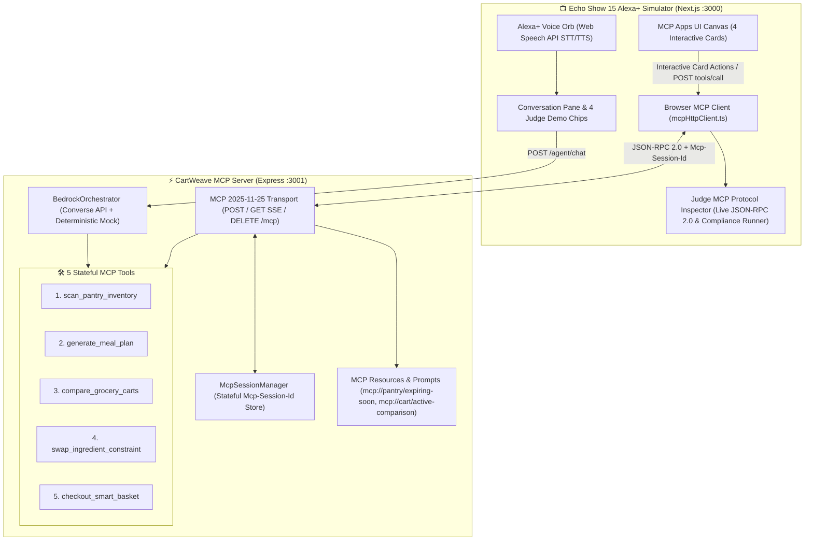

<div align="center">

# 🛒 CartWeave
### Alexa+ Multi-Brand Pantry, Meal-Plan & Grocery Arbitrage Concierge

A self-hosted **Model Context Protocol (MCP `2025-11-25` Streamable HTTP)** server and **Amazon Echo Show 15 Multimodal Alexa+ Simulator** powered by **Amazon Bedrock Converse API**. Automates expiring pantry rescue, high-protein meal planning, and multi-retailer grocery arbitrage across Amazon Fresh, Whole Foods Market, and Local Neighborhood Co-op.

[](./LICENSE)
[](https://modelcontextprotocol.io/specification/2025-11-25/basic/transports)
[](https://aws.amazon.com/bedrock/)
[](https://developer.amazon.com/docs/alexaplus/add-ons/mcp-toolkit-overview.html)
[](https://nextjs.org/)
[](https://nodejs.org/)

<br>

<p align="center">
  <a href="#-overview"><b>Overview</b></a> •
  <a href="#-key-features"><b>Key Features</b></a> •
  <a href="#-hackathon-prize-alignment"><b>Prize Tracks</b></a> •
  <a href="#-system-architecture"><b>Architecture</b></a> •
  <a href="#-the-5-stateful-mcp-tools"><b>MCP Tools</b></a> •
  <a href="#-quick-start"><b>Quick Start</b></a> •
  <a href="#-3-minute-judge-demo-script"><b>Judge Demo</b></a> •
  <a href="#-project-structure"><b>Structure</b></a> •
  <a href="#-connect--author"><b>Connect</b></a>
</p>

</div>

---

## 📖 Overview

Instead of static shopping lists or isolated timers, imagine a household member speaking naturally to their kitchen Echo Show 15:

> *"Alexa, my baby spinach, paneer, and Greek yogurt expire tomorrow—plan 3 high-protein dinners under $38 and compare Amazon Fresh vs. Whole Foods for the missing ingredients."*

**CartWeave** orchestrates **5 stateful MCP tools** over a single `Mcp-Session-Id` session, prioritizes expiring fridge inventory to prevent food waste, computes per-serving protein and calorie macros, performs real-time price and substitution arbitrage across **Amazon Fresh**, **Whole Foods Market**, and a **Local Co-op**, and returns interactive **MCP Apps UI** cards where users can swap meals, filter dietary constraints, or check out in a single tap.

---

## ✨ Key Features

| Capability | Technical Implementation & User Benefit |
| :--- | :--- |
| **🌐 MCP `2025-11-25` Streamable HTTP** | Full implementation of `POST /mcp`, `GET /mcp` (Server-Sent Events), and `DELETE /mcp` with stateful `Mcp-Session-Id` header tracking and `Access-Control-Expose-Headers` configuration. |
| **🧠 Amazon Bedrock Converse Orchestration** | Chained multi-tool reasoning via `@aws-sdk/client-bedrock-runtime` supporting Anthropic Claude 3.5 Sonnet and Amazon Nova Pro, with an automated fallback to a zero-cost deterministic mock (`USE_MOCK_BEDROCK=true`). |
| **🥗 Expiry-First Pantry Optimization** | `scan_pantry_inventory` scans refrigerated items, computes hours until spoilage, and calculates total food waste dollars saved upon completing a meal plan. |
| **⚖️ Multi-Retailer Grocery Arbitrage** | `compare_grocery_carts` contrasts itemized carts across **Amazon Fresh**, **Whole Foods Market**, and **Local Co-op**, surfacing brand substitutions, Prime member savings, and hybrid split orders. |
| **🔄 In-Session Constraint Mutation** | `swap_ingredient_constraint` enables mid-conversation modifications (e.g. *"Swap Day 2 to dairy-free under 520 kcal"*) without resetting the session context or re-prompting. |
| **📺 Echo Show 15 Multimodal Simulator** | Next.js 14 split-screen simulator integrating Web Speech API STT/TTS, conversation timeline with 4 one-click Judge Demo chips, interactive MCP Apps cards, and a live Protocol Inspector. |
| **🛡️ Built-In Protocol Inspector & Test Runner** | Real-time JSON-RPC 2.0 frame monitor with a one-click automated MCP compliance test runner validating all 5 tools, resources, and prompts. |

---

## 🏆 Hackathon Prize Alignment

Built for the **Build, Ship, Shape: Amazon Developer Hackathon**:

| Prize Track | Implementation in CartWeave |
| :--- | :--- |
| **🥇 Primary Track — Alexa+** | Implements the official **MCP `2025-11-25` Streamable HTTP** specification (`POST`, `GET` SSE, `DELETE`), exposes `Mcp-Session-Id` session headers, and renders 4 rich multimodal **MCP Apps UI** widgets (`PANTRY_EXPIRY_GRID`, `MEAL_PLAN_MACRO_CARDS`, `STORE_ARBITRAGE_TABLE`, `ORDER_CONFIRMATION_CARD`) inside an Echo Show 15 simulator. |
| **🛠️ Mini Challenge — AWS Builder** | Integrates `@aws-sdk/client-bedrock-runtime` (`ConverseCommand`) with live Claude 3.5 Sonnet and Amazon Nova Pro support, includes an automated zero-cost deterministic mock planner, and packages a complete AWS SAM infrastructure-as-code template ([`template.yaml`](./template.yaml)). |
| **📖 Mini Challenge — Open Source** | Clean MIT-licensed monorepo ([`LICENSE`](./LICENSE)), automated specification compliance test suite (`npm run test:mcp`), system architecture diagrams, a 3-minute judge script, and a detailed 5-point Developer Friction Log ([`FRICTION_LOG.md`](./FRICTION_LOG.md)). |

---

## 🏛️ System Architecture

The following diagram illustrates CartWeave's client-server architecture, MCP `2025-11-25` Streamable HTTP transport, stateful session handling, and Bedrock orchestrator:



---

## 🛠️ The 5 Stateful MCP Tools

CartWeave exposes 5 stateful MCP tools over the `2025-11-25` transport, returning both token-efficient text for LLM chaining and structured `mcp_app_ui` cards for the display:

```
+---------------------------------------------------------------------------------------------------------+
|                                    CartWeave Tool Execution Flow                                        |
+---------------------------------------------------------------------------------------------------------+
|                                                                                                         |
|  1. scan_pantry_inventory    -->  Finds items expiring soon (Spinach: 18h, Yogurt: 24h, Paneer: 36h)   |
|                                         |                                                               |
|  2. generate_meal_plan       -->  Generates 3 dinners under budget (39g avg protein, $31.40 cost)       |
|                                         |                                                               |
|  3. compare_grocery_carts    -->  Evaluates missing ingredients across Amazon Fresh vs Whole Foods vs Co-op |
|                                         |                                                               |
|  4. swap_ingredient_constraint -> Mutates Day 2 dish (Dairy-Free <520 kcal) without resetting session  |
|                                         |                                                               |
|  5. checkout_smart_basket    -->  Locks delivery slot, generates tracking code, saves $18.45 in waste   |
|                                                                                                         |
+---------------------------------------------------------------------------------------------------------+
```

| Tool Name | Parameters | Core Responsibility & Return Payload |
| :--- | :--- | :--- |
| **`scan_pantry_inventory`** | `filter_category?`, `max_hours_to_spoil?` | Inspects stored pantry inventory, flags high-urgency items, computes hours to spoil, and returns the `PANTRY_EXPIRY_GRID` widget. |
| **`generate_meal_plan`** | `days`, `target_protein_per_day_g?`, `max_budget_dollars?`, `dietary_tags?` | Creates a multi-day culinary plan utilizing expiring items, calculates per-serving macros, and renders `MEAL_PLAN_MACRO_CARDS`. |
| **`compare_grocery_carts`** | `target_stores?`, `enable_substitutions?` | Analyzes missing ingredients across Amazon Fresh, Whole Foods, and Local Co-op, presenting the `STORE_ARBITRAGE_TABLE`. |
| **`swap_ingredient_constraint`** | `day_number`, `avoid_ingredient?`, `max_calories?`, `preferred_protein_source?` | Replaces a specific meal in place while preserving session context and recalculating store totals. |
| **`checkout_smart_basket`** | `store_id`, `delivery_window`, `confirm_order` | Finalizes the order, deducts used inventory from the pantry, and outputs the `ORDER_CONFIRMATION_CARD`. |

---

## 📱 Interactive Multimodal Cards (`mcp_app_ui`)

CartWeave's Echo Show 15 simulator renders 4 interactive visual cards paired with spoken voice responses:

1. **`PANTRY_EXPIRY_GRID`**: Color-coded urgency badges (red: <24h, amber: <48h, green: fresh), item quantities, and estimated discard values.
2. **`MEAL_PLAN_MACRO_CARDS`**: 3-day meal breakdown highlighting used pantry items, missing grocery items, calorie counts, and protein macros. Includes an inline **"Swap Dish"** action button.
3. **`STORE_ARBITRAGE_TABLE`**: Side-by-side comparison of Amazon Fresh vs. Whole Foods Market vs. Local Co-op, including brand substitutions, Prime member discounts, and delivery speed.
4. **`ORDER_CONFIRMATION_CARD`**: Receipt showing delivery window, one-tap tracking link, itemized total, and total food waste dollars saved ($18.45).

---

## 🚀 Quick Start (Zero-Config Local Run)

### Prerequisites
* **Node.js** `>= 20.x` and **npm** `>= 10.x`
* No AWS credentials required by default (`USE_MOCK_BEDROCK=true` is enabled out of the box; set `USE_MOCK_BEDROCK=false` and provide AWS credentials to connect to live Amazon Bedrock).

### 1. Clone the Repository
```bash
git clone https://github.com/harinarayana1457-cmyk/CartWeave.git
cd CartWeave
```

### 2. Install Workspace Dependencies
```bash
npm install
```

### 3. Run Automated MCP 2025-11-25 Compliance Suite
```bash
npm run test:mcp
```
*Validates the `initialize` handshake (`protocolVersion === "2025-11-25"`), asserts `Mcp-Session-Id` header persistence, tests `tools/list`, `resources/list`, `resources/read`, `prompts/list`, `prompts/get`, and executes all 5 stateful `tools/call` operations while verifying non-empty `mcp_app_ui` structured payloads.*

### 4. Launch Development Servers (MCP Server + Simulator)
```bash
npm run dev
```

* **Echo Show 15 Alexa+ Simulator**: [`http://localhost:3000`](http://localhost:3000)
* **MCP 2025-11-25 Streamable HTTP Endpoint**: [`http://localhost:3001/mcp`](http://localhost:3001/mcp)
* **Health & Diagnostics**: [`http://localhost:3001/health`](http://localhost:3001/health)

---

## ⏱️ 3-Minute Judge Demo Script

Follow this step-by-step walkthrough in the Echo Show 15 simulator:

```
+---------------------------------------------------------------------------------------------+
|                          Echo Show 15 Multimodal Simulator                                  |
+-------------------------------------------------------------+-------------------------------+
|  Alexa+ Voice Orb (STT / TTS Active)                        |  MCP Apps UI Canvas           |
|                                                             |                               |
|  [ Chip 1: Scan & Plan ]     [ Chip 2: Price Arbitrage ]    |  [ Pantry Inventory Grid ]    |
|  [ Chip 3: Swap Constraint ] [ Chip 4: Checkout Basket ]    |  [ 3-Day Meal & Macro Plan ]  |
|                                                             |  [ 3-Store Arbitrage Table ]  |
|  Conversation Timeline:                                     |  [ Order Confirmation Card ]  |
|  > "Scan pantry and plan 3 high-protein dinners under $38"  |                               |
|  < "I found spinach & yogurt expiring. Planned 3 meals..."  |  Bottom Drawer:               |
|                                                             |  [ Protocol Inspector (JSON) ]|
+-------------------------------------------------------------+-------------------------------+
```

1. **0:00 – 0:30 | MCP 2025-11-25 Handshake & Session Verification**:
   - Open `http://localhost:3000`. Observe the top status bar displaying `MCP 2025-11-25 Streamable HTTP • Connected` along with the active `Mcp-Session-Id` UUID badge.
   - Click **"Protocol Inspector"** in the top-right to inspect real `initialize`, `tools/list`, and `resources/list` JSON-RPC 2.0 frames captured during boot.
2. **0:30 – 1:15 | Pantry Rescue & High-Protein Meal Planning**:
   - Click **Judge Demo Chip #1**: *"Scan my pantry for expiring items and plan 3 high-protein vegetarian dinners under $38."*
   - CartWeave chains `scan_pantry_inventory` (flagging Baby Spinach in 18h, Greek Yogurt in 24h, Paneer in 36h) and `generate_meal_plan` (3 dinners averaging **39g protein/meal** at **$31.40 total**).
3. **1:15 – 2:00 | 3-Retailer Grocery Price & Substitution Arbitrage**:
   - Click **Judge Demo Chip #2**: *"Compare Amazon Fresh vs. Whole Foods for the missing ingredients."*
   - Inspect the **Store Arbitrage** table contrasting **Amazon Fresh**, **Whole Foods Market**, and **Local Co-op** with Prime discounts and delivery time estimates.
4. **2:00 – 2:35 | Stateful Mid-Conversation Constraint Mutation**:
   - Click **Judge Demo Chip #3**: *"Swap Day 2 for a dairy-free dish under 520 calories and recalculate."* (or click **"Swap Dish"** on the Day 2 card).
   - `swap_ingredient_constraint` mutates the active session in place, replacing Day 2 with a **Crispy Tofu & Edamame Sesame Quinoa Bowl (480 kcal, 36g protein, Dairy-Free)** and updating store totals automatically.
5. **2:35 – 3:00 | One-Tap Smart Basket Checkout & Compliance Self-Test**:
   - Click **Judge Demo Chip #4**: *"Checkout the Amazon Fresh basket for the 6:00 PM – 7:00 PM delivery window."*
   - View the **Order Confirmation Card** showing the delivery tracking code and **$18.45 in avoided food waste**.
   - Open the **Protocol Inspector** and click **"Run MCP 2025-11-25 Compliance Check"** to execute all 5 tools sequentially with green pass verification badges.

---

## 📁 Project Structure

```
CartWeave/
├── packages/
│   ├── mcp-server/                           # Self-hosted MCP 2025-11-25 Streamable HTTP Server
│   │   ├── src/
│   │   │   ├── aws/
│   │   │   │   └── bedrockAgent.ts           # Amazon Bedrock Converse API + Mock Planner
│   │   │   ├── data/
│   │   │   │   └── seedData.ts               # Seed pantry items, store catalog & recipe DB
│   │   │   ├── prompts/
│   │   │   │   └── mcpPrompts.ts             # MCP Prompts handler (mcp://prompts/pantry-rescue)
│   │   │   ├── resources/
│   │   │   │   └── mcpResources.ts           # MCP Resources handler (mcp://pantry/expiring-soon)
│   │   │   ├── test/
│   │   │   │   └── verifyMcpSpec.ts          # Automated MCP 2025-11-25 Compliance Test Suite
│   │   │   ├── tools/                        # 5 Stateful MCP Tool Implementations
│   │   │   │   ├── scanPantry.ts
│   │   │   │   ├── generateMealPlan.ts
│   │   │   │   ├── compareCarts.ts
│   │   │   │   ├── swapConstraint.ts
│   │   │   │   └── checkoutBasket.ts
│   │   │   ├── index.ts                      # Express HTTP transport (POST/GET/DELETE /mcp)
│   │   │   └── mcpSessionManager.ts          # Mcp-Session-Id state tracking & SSE streams
│   │   ├── package.json
│   │   └── tsconfig.json
│   │
│   └── alexa-plus-simulator/                 # Echo Show 15 Multimodal Alexa+ Simulator
│       ├── src/
│       │   ├── app/
│       │   │   ├── layout.tsx
│       │   │   ├── page.tsx                  # Split-screen Echo Show 15 layout
│       │   │   └── globals.css
│       │   ├── components/
│       │   │   ├── AlexaVoiceOrb.tsx         # Animated Voice Orb with Web Speech API
│       │   │   ├── ConversationPane.tsx      # Chat transcript & 4 Judge Demo chips
│       │   │   ├── EchoShowFrame.tsx         # Echo Show 15 hardware bezel & status bar
│       │   │   ├── McpAppsCanvas.tsx         # Multimodal cards container
│       │   │   ├── McpProtocolInspector.tsx  # JSON-RPC 2.0 inspector drawer & test runner
│       │   │   └── cards/                    # 4 Interactive MCP Apps UI Cards
│       │   │       ├── PantryExpiryCard.tsx
│       │   │       ├── MealPlanMacroCard.tsx
│       │   │       ├── StoreArbitrageCard.tsx
│       │   │       └── OrderConfirmationCard.tsx
│       │   └── lib/
│       │       └── mcpHttpClient.ts          # Browser MCP Streamable HTTP Client
│       ├── package.json
│       └── tailwind.config.ts
│
├── FRICTION_LOG.md                           # Detailed 5-point Developer Friction Log
├── template.yaml                             # Production AWS SAM template (Lambda + DynamoDB)
├── package.json                              # Root workspace scripts (npm run dev, test:mcp)
└── README.md                                 # Project documentation
```

---

## 🛠️ Tech Stack

| Layer | Technology | Version | Purpose |
| :--- | :--- | :--- | :--- |
| **Protocol Transport** | [Model Context Protocol](https://modelcontextprotocol.io/) | `2025-11-25` | Stateful Streamable HTTP transport (`POST /mcp`, `GET /mcp` SSE, `DELETE /mcp`) |
| **Cloud AI Orchestration** | [Amazon Bedrock](https://aws.amazon.com/bedrock/) | SDK `v3.700` | Multi-turn tool calling via `ConverseCommand` (Claude 3.5 Sonnet / Nova Pro) |
| **Backend Runtime** | [Node.js](https://nodejs.org/) & [Express](https://expressjs.com/) | Node 20+, Express 4 | High-throughput HTTP & SSE server with custom CORS session headers |
| **Type Validation** | [Zod](https://zod.dev/) & [TypeScript](https://www.typescriptlang.org/) | Zod 3.24, TS 5.7 | Strict runtime input/output schemas for all 5 MCP tools and JSON-RPC payloads |
| **Frontend Framework** | [Next.js](https://nextjs.org/) & [React](https://react.dev/) | Next 14.2, React 18 | SSR/Client split-screen Echo Show 15 simulator application |
| **Styling & Icons** | [Tailwind CSS](https://tailwindcss.com/) & [Lucide](https://lucide.dev/) | Tailwind 3.4, Lucide | Echo Show 15 device styling, responsive cards, and clean visual indicators |
| **Voice Interface** | [Web Speech API](https://developer.mozilla.org/en-US/docs/Web/API/Web_Speech_API) | Native Browser | In-browser Speech-to-Text (`SpeechRecognition`) and Alexa TTS synthesis |
| **Cloud Deployment** | [AWS SAM](https://aws.amazon.com/serverless/sam/) | SAM CLI / CloudFormation | Serverless packaging for AWS Lambda, API Gateway HTTP API, and DynamoDB |

---

## 📄 License

Distributed under the **[MIT License](https://opensource.org/licenses/MIT)**. See [`LICENSE`](./LICENSE) for full details.

---

## 🔗 Connect & Author

**Harinarayana Avvari**

[](https://www.linkedin.com/in/hari-narayana-035ba1389/)
[](https://github.com/harinarayana1457-cmyk)

<div align="center">
  <sub>Built for the Build, Ship, Shape: Amazon Developer Hackathon. Empowering smart, zero-waste kitchen economies with Alexa+ and Model Context Protocol.</sub>
</div>
