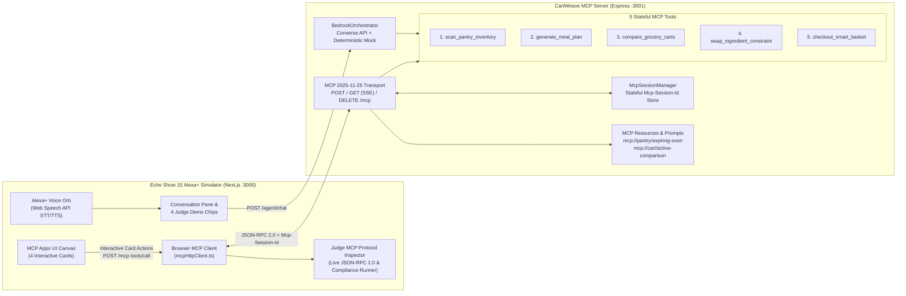

# CartWeave — Alexa+ Multi-Brand Pantry, Meal-Plan & Grocery Arbitrage Concierge

[](./LICENSE)
[](https://modelcontextprotocol.io/specification/2025-11-25/basic/transports)
[](https://aws.amazon.com/bedrock/)
[](https://developer.amazon.com/docs/alexaplus/add-ons/mcp-toolkit-overview.html)

**CartWeave** is a self-hosted **Model Context Protocol (`2025-11-25` Streamable HTTP)** server and **Amazon Echo Show 15 Alexa+ Multimodal Simulator** built for the **Build, Ship, Shape: Amazon Developer Hackathon**.

Instead of static shopping lists or single-turn timers, a household member can speak naturally to their Echo Show 15 kitchen display:

> *"Alexa, my baby spinach, paneer, and Greek yogurt expire tomorrow—plan 3 high-protein dinners under $38 and compare Amazon Fresh vs. Whole Foods for the missing ingredients."*

CartWeave orchestrates 5 stateful MCP tools over a single `Mcp-Session-Id` session, prioritizes expiring fridge inventory to eliminate food waste, computes per-serving protein/calorie macros, runs real-time price and substitution arbitrage across **Amazon Fresh**, **Whole Foods Market**, and **Local Neighborhood Co-op**, and renders interactive **MCP Apps UI** widgets where users can swap dishes, filter dietary constraints, or check out in one tap.

---

## Prize Track Alignment

1. **Primary Track — Alexa+ (`MCP 2025-11-25 Streamable HTTP` + Multimodal MCP Apps UI)**:
   - Implements `POST /mcp`, `GET /mcp` (SSE notifications), and `DELETE /mcp` with stateful `Mcp-Session-Id` headers and `Access-Control-Expose-Headers: Mcp-Session-Id`.
   - Returns rich `mcp_app_ui` structured widget payloads (`PANTRY_EXPIRY_GRID`, `MEAL_PLAN_MACRO_CARDS`, `STORE_ARBITRAGE_TABLE`, `ORDER_CONFIRMATION_CARD`) rendered interactively in an Echo Show 15 simulator.
2. **Mini Challenge — AWS Builder**:
   - Integrates `@aws-sdk/client-bedrock-runtime` (`ConverseCommand`) supporting `us.anthropic.claude-3-5-sonnet-20241022-v2:0` and `amazon.nova-pro-v1:0`, paired with a zero-cost `USE_MOCK_BEDROCK=true` deterministic multi-tool planner fallback and a production AWS SAM deployment template ([`template.yaml`](./template.yaml)).
3. **Mini Challenge — Open Source**:
   - MIT-licensed monorepo ([`LICENSE`](./LICENSE)), automated MCP 2025-11-25 compliance test suite (`npm run test:mcp`), full architecture diagrams, 3-minute judge demo script, and structured [`FRICTION_LOG.md`](./FRICTION_LOG.md).

---

## System Architecture



---

## Quick Start (Zero-Config Local Run)

### Prerequisites
- **Node.js** `>= 20.x` and **npm** `>= 10.x`
- No AWS credentials required by default (`USE_MOCK_BEDROCK=true` is active out of the box; set `USE_MOCK_BEDROCK=false` and configure AWS credentials to use live Amazon Bedrock).

### 1. Install Dependencies
```bash
npm install
```

### 2. Run the Automated MCP 2025-11-25 Compliance Suite
```bash
npm run test:mcp
```
This spins up the MCP server on an ephemeral port, verifies the `initialize` handshake (`protocolVersion === "2025-11-25"`), asserts `Mcp-Session-Id` header persistence, tests `tools/list`, `resources/list`, `resources/read`, `prompts/list`, `prompts/get`, and executes all 5 stateful `tools/call` operations while validating non-empty `mcp_app_ui` payloads.

### 3. Launch Both Servers (`:3001` MCP Server + `:3000` Echo Show 15 Simulator)
```bash
npm run dev
```
- **Alexa+ Multimodal Simulator**: `http://localhost:3000`
- **MCP 2025-11-25 Streamable HTTP Endpoint**: `http://localhost:3001/mcp`
- **Health & Server Status**: `http://localhost:3001/health`

---

## 3-Minute Judge Demo Script

1. **0:00 – 0:30 | Live MCP 2025-11-25 Handshake Inspection**:
   - Open `http://localhost:3000`. Notice the top status bar on the Echo Show 15 frame displaying `MCP 2025-11-25 Streamable HTTP • Connected` and the active `Mcp-Session-Id` UUID badge.
   - Click **"Protocol Inspector"** in the top-right bar (or expand the bottom drawer) to inspect the real `initialize`, `tools/list`, and `resources/list` JSON-RPC 2.0 frames captured on startup.
2. **0:30 – 1:15 | Multi-Tool Pantry Rescue & High-Protein Meal Planning**:
   - Click **Judge Demo Chip #1**: *"Scan my pantry for expiring items and plan 3 high-protein vegetarian dinners under $38."*
   - Watch the Alexa+ Voice Orb animate as CartWeave chains `scan_pantry_inventory` (flagging Baby Spinach expiring in 18h, Greek Yogurt in 24h, Paneer in 36h, and Hass Avocado in 40h) and `generate_meal_plan` (3 vegetarian dinners averaging **39g protein/meal** and **$31.40 total**).
   - Switch between the **Pantry Inventory** and **3-Day Meal & Macro Plan** tabs on the right canvas.
3. **1:15 – 2:00 | 3-Retailer Grocery Price & Substitution Arbitrage**:
   - Click **Judge Demo Chip #2**: *"Compare Amazon Fresh vs. Whole Foods for the missing ingredients."*
   - Inspect the **3-Store Price Arbitrage** table comparing **Amazon Fresh**, **Whole Foods Market**, and **Local Co-op** item-by-item, complete with smart brand substitutions, Prime delivery savings, and hybrid split recommendations.
4. **2:00 – 2:35 | Stateful Mid-Conversation Constraint Mutation**:
   - Click **Judge Demo Chip #3**: *"Swap Day 2 for a dairy-free dish under 520 calories and recalculate."* (or click **"Swap Dish (Dairy-Free <520 kcal)"** directly on Day 2's card).
   - Observe `swap_ingredient_constraint` mutate the active session in place, swapping Day 2 to **Crispy Tofu & Edamame Sesame Quinoa Bowl (480 kcal, 36g protein, Dairy-Free)** and recalculating store totals automatically.
5. **2:35 – 3:00 | One-Tap Smart Basket Checkout & Compliance Self-Test**:
   - Click **Judge Demo Chip #4**: *"Checkout the Amazon Fresh basket for the 6:00 PM – 7:00 PM delivery window."*
   - View the **Order Confirmation Card** showing the tracking code, deducted expiring pantry items, and **$18.45 in avoided food waste**.
   - Open the **Protocol Inspector** and click **"Run MCP 2025-11-25 Compliance Check"** to watch all 5 tools execute sequentially with green pass badges.
